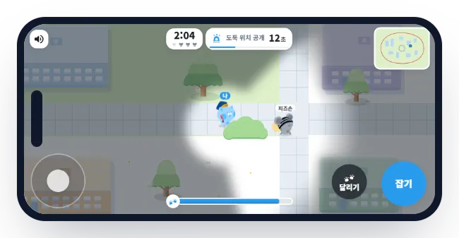
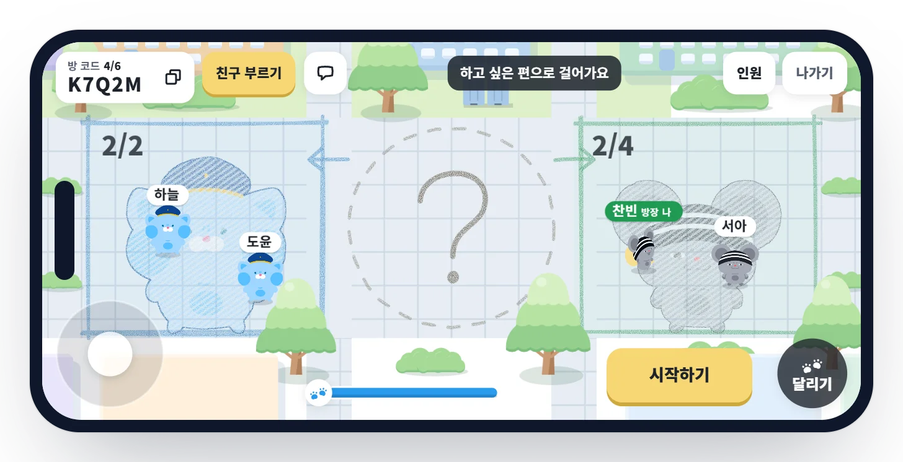
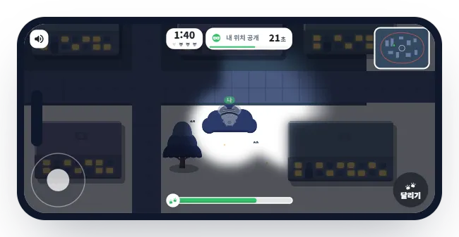
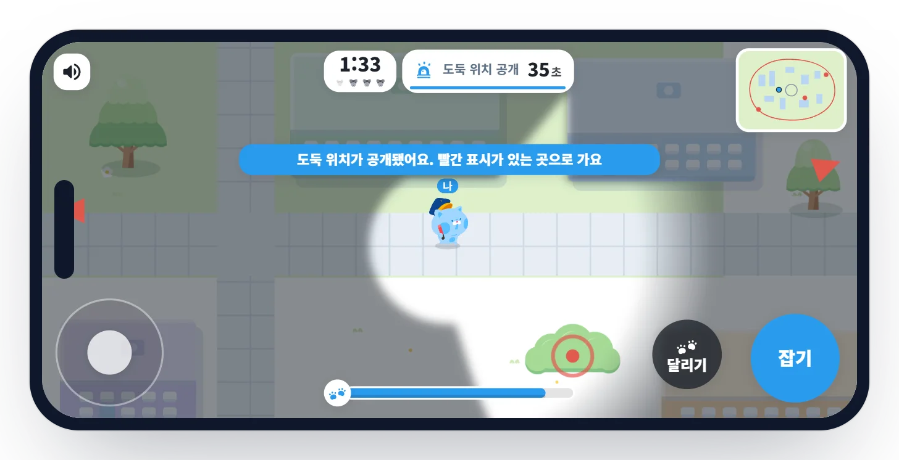
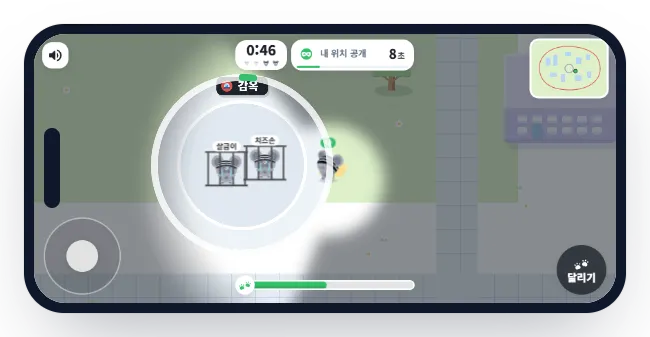

<div align="center">


### 친구에게 링크를 보내 폰이나 컴퓨터에서 같이 하는 경찰과 도둑

설치 없이 브라우저에서 해요. 최대 8명, 한 판 3분이에요.

[게임 소개 페이지](https://copsandrobbers.app/online) &nbsp;|&nbsp; [오프라인 경찰과 도둑 앱](https://copsandrobbers.app)

<br>



</div>

<br>

> [!NOTE]
> 지금은 팀이 시험하는 중이에요. 공개되면 게임 소개 페이지의 버튼으로 바로 들어갈 수 있어요.

## 한 판은 이렇게 흘러가요

<table>
<tr>
<td width="50%" valign="top">
<br>
<b>링크 하나로 모여요</b><br>
방을 만들고 링크나 방 코드를 보내면 친구가 들어와요. 대기실에서 경찰 칸이나 도둑 칸으로 걸어가면 그 편이 돼요.
</td>
<td width="50%" valign="top">
<br>
<b>바라보는 쪽만 보여요</b><br>
바라보는 쪽만 멀리 보여요. 도둑은 수풀에 숨고, 경찰은 시야를 돌려 가며 찾아요.
</td>
</tr>
<tr>
<td width="50%" valign="top">
<br>
<b>35초마다 위치가 드러나요</b><br>
도둑 자리가 지도에 잠깐 빨간 표시로 떠요. 경찰은 그쪽으로 달려가고, 도둑은 얼른 자리를 옮겨요.
</td>
<td width="50%" valign="top">
<br>
<b>같은 편이 감옥에서 꺼내 줘요</b><br>
잡힌 도둑은 감옥으로 가요. 같은 편이 감옥 문 앞에 잠깐 서 있으면 풀려나요. 경찰은 그전에 막아야 해요.
</td>
</tr>
</table>

## 규칙

| | 경찰 | 도둑 |
| --- | --- | --- |
| 이기는 법 | 도둑을 모두 감옥에 보내요 | 3분 동안 한 명이라도 버텨요 |
| 시작 | 15초 뒤에 출동해요 | 그동안 흩어져 숨어요 |
| 시야 | 바라보는 쪽만 멀리 보여요. 내가 보는 상대도 나를 볼 수 있어요 | 수풀 안에 있으면 아주 가까이 와야 보여요 |
| 위치 공개 | 35초마다 도둑 자리가 지도에 떠요 | 공개되면 얼른 자리를 옮겨요 |
| 구역 | 밖에 나가면 앞이 거의 안 보여요 | 밖에 5초 넘게 있으면 위치가 경찰에게 보여요 |
| 감옥 | 감옥 앞을 지켜 구출을 막아요 | 같은 편이 문 앞에 서면 열려요. 밖으로 나가 3초가 지나면 탈옥이고, 그동안은 잡히지 않아요 |

지도는 다섯 가지(동네, 밤 골목, 공원, 도심, 눈 마을)가 판마다 새로 만들어지고, 인원이 많을수록 넓어져요(8명이면 가로세로 1.2배). 빈자리와 끊긴 사람의 자리는 봇이 맡고, 30초 안에 돌아오면 이어서 해요.

## 어떻게 돌아가나

| 부분 | 하는 일 |
| --- | --- |
| 화면 `client/` | 앱과 같은 캐릭터 그림을 부위별로 움직여요. 빌드하면 파일 하나로 묶여요 |
| 규칙 `shared/logic.js` | 이동, 시야, 잡기, 감옥, 지도 만들기, 봇. 서버와 혼자 하는 연습 판이 같은 코드를 써요 |
| 방 서버 `server/room.ts` | 방마다 Cloudflare Durable Object 하나. 판이 돌 때 초당 20번 규칙을 돌리고, 대기 중에는 잠들어요 |
| 보내는 내용 `shared/view.js` | 서버가 판정하고, 내 시야 밖 상대의 위치는 아예 보내지 않아요. 통신을 들여다봐도 숨은 상대가 안 보여요 |
| 입구 `gateway/` | `pages.dev` 로 들어와요. 한국에서 서울 Cloudflare 로 들어가 KT 폰 왕복이 36ms 였어요 |
| 운영 상태 `server/control.ts` | 공개 전, 누구나, 점검 중을 웹사이트 어드민에서 바꿔요. 판 결과도 이름 없이 한 줄씩 남겨요 |

무료 요금제 안에서 돌아가게 짰어요. 입력 횟수와 메시지 크기에 상한을 두고, 오늘 사용량이 무료 한도의 70% 를 넘으면 자동 배포를 멈춰요. 계산은 [docs/cost-guard.md](docs/cost-guard.md) 에 있어요.

## 직접 돌려 보기

Node 22 와 pnpm 이 필요해요.

```bash
pnpm install
pnpm run check   # 타입, 지도, 방 섞임, 시야, 규칙 검사와 가짜 접속 한 판. 전부 내 컴퓨터에서 돌아 비용이 없어요
pnpm run build   # 게임을 dist/game.html 하나로 묶어요. 브라우저로 열면 봇과 혼자 해 볼 수 있어요
```

`main` 에 머지되면 GitHub Actions 가 검사하고 방 서버와 입구를 올려요([docs/deploy.md](docs/deploy.md)).

## 문서

| 문서 | 내용 |
| --- | --- |
| [architecture.md](docs/architecture.md) | 구조와 한 판의 흐름, 고른 이유, 입구 측정 |
| [protocol.md](docs/protocol.md) | 화면과 서버가 주고받는 메시지, 누구에게 무엇을 보내나 |
| [ops.md](docs/ops.md) | 공개 전, 점검 중 바꾸기와 어드민 API, 판 결과 읽기 |
| [cost-guard.md](docs/cost-guard.md) | 무료 한도와 안전장치 |
| [deploy.md](docs/deploy.md) | 자동 배포와 처음 한 번 설정 |
| [tutorial.md](docs/tutorial.md) | 처음 하는 사람을 위한 안내 |
| [sound.md](docs/sound.md) | 효과음과 출처 |
| [conventions.md](docs/conventions.md) | 이슈, 브랜치, 커밋, PR 방식 |
| [roadmap.md](docs/roadmap.md) | 앞으로 할 일 |

## 저작권

코드와 캐릭터 그림의 권리는 팀 동심지키미에게 있어요. 라이선스를 따로 붙이지 않았으니 허락 없이 다른 곳에 쓸 수 없어요. 효과음은 출처와 라이선스를 [client/brand/sound/LICENSE.md](client/brand/sound/LICENSE.md) 에 적었어요.
